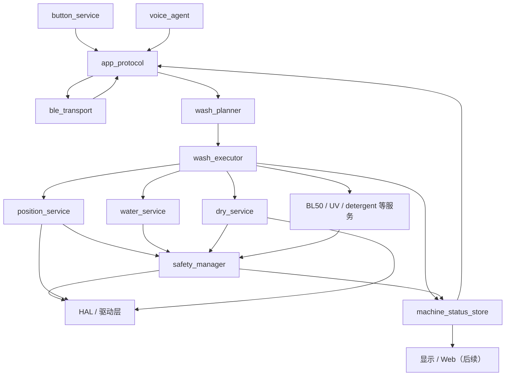
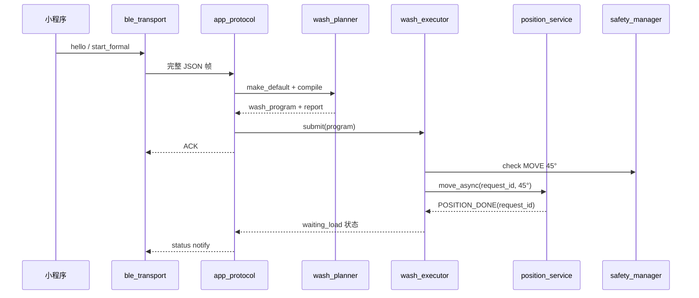

# ESP-IDF 重构：组件拆分与任务模型设计

> 本文冻结第一版 ESP-IDF 软件边界，重点定义 `position_service`、`water_service`、`dry_service`、`wash_planner`、`safety_manager`、`ble_transport`、`voice_agent` 的责任、任务模型和 C 接口。具体驱动实现、洗涤参数和硬件标定值后续再细化。

## 1. 设计结论

新版固件不再让 BLE、语音或按钮直接向执行器塞裸硬件命令。统一数据链路为：

```text
按钮 / BLE / 语音
    -> app_protocol（统一业务命令）
    -> wash_planner（纯计算：意图编译为安全步骤）
    -> wash_executor（唯一流程状态机）
    -> position / water / dry 等异步服务
    -> safety_manager（运行时授权、联锁、故障和紧急关闭）
    -> HAL/驱动
```

核心约束：

- `wash_planner` 不访问硬件、不创建任务，只做确定性的计划编译和静态校验。
- `wash_executor` 是整机流程的唯一所有者，同一时刻只执行一个洗涤程序和一个主步骤。
- `position_service`、`water_service`、`dry_service` 都是异步服务；开始操作后通过事件报告完成、取消或故障。
- 所有异步请求都带 `request_id`，防止旧操作的迟到事件误完成新步骤。
- MCP23017、IBT-2、BL50、风扇等驱动不能被多个业务组件直接争用。
- PTC、进水阀、转移阀、排水阀、UV、洗衣液泵等高风险输出必须经过 `safety_manager` 授权。
- BTN3 的中断复位走高优先级控制通道，不等待普通 BLE/语音队列排队。
- 云端 LLM 只能产生产品动作意图，不能产生 GPIO、MCP、PWM、继电器或裸电机控制。

## 2. 分层与组件关系



说明：

- 图中的 `wash_executor`、`app_protocol` 和 `machine_status_store` 是七个目标组件之间必须存在的胶水层，本文同时约束其最小职责。
- `position_service` 正常情况下独占 IBT-2；`dry_service` 正常情况下独占风扇。`safety_manager` 保留紧急停机通道。
- `water_service` 不直接写 MCP 输出，所有阀门开关通过 `safety_manager` 执行。
- 状态上报使用快照，不让 BLE/显示任务直接读取服务内部变量。

## 3. 公共数据契约

建议建立公共组件 `machine_types`，仅存放稳定的数据类型，不包含业务实现。

### 3.1 基础枚举

```c
// components/machine_types/include/machine_types.h
#pragma once

#include <stdbool.h>
#include <stddef.h>
#include <stdint.h>
#include "esp_err.h"

typedef uint32_t machine_request_id_t;

typedef enum {
    APP_SOURCE_BUTTON = 0,
    APP_SOURCE_BLE,
    APP_SOURCE_VOICE,
    APP_SOURCE_WEB,
    APP_SOURCE_SYSTEM,
} app_source_t;

typedef enum {
    DRUM_POS_UNKNOWN = -1,
    DRUM_POS_0       = 0,
    DRUM_POS_45      = 45,
    DRUM_POS_90      = 90,
    DRUM_POS_180     = 180,
    DRUM_POS_270     = 270,
} drum_position_t;

typedef enum {
    MACHINE_STATE_BOOTING = 0,
    MACHINE_STATE_IDLE,
    MACHINE_STATE_WAITING_LOAD,
    MACHINE_STATE_RUNNING,
    MACHINE_STATE_WAITING_UNLOAD,
    MACHINE_STATE_UV,
    MACHINE_STATE_PAUSED,
    MACHINE_STATE_RESETTING,
    MACHINE_STATE_FAULT,
} machine_state_t;

typedef enum {
    WASH_PHASE_IDLE = 0,
    WASH_PHASE_MOVE_POSITION,
    WASH_PHASE_HOME_BL50,
    WASH_PHASE_WATER_SOURCE_FILL,
    WASH_PHASE_WATER_TRANSFER,
    WASH_PHASE_DETERGENT,
    WASH_PHASE_PULSATOR_WASH,
    WASH_PHASE_DRUM_WASH,
    WASH_PHASE_DRAIN,
    WASH_PHASE_SPIN,
    WASH_PHASE_DRY,
    WASH_PHASE_UV,
    WASH_PHASE_DONE,
} wash_phase_t;
```

### 3.2 统一故障码

```c
typedef enum {
    FAULT_NONE = 0,
    FAULT_HALL_CONFLICT,
    FAULT_POSITION_TIMEOUT,
    FAULT_POSITION_DRIVER,
    FAULT_WATER_NO_FLOW,
    FAULT_WATER_TIMEOUT,
    FAULT_WATER_LEVEL_INVALID,
    FAULT_SHT_INVALID,
    FAULT_DRY_OVERTEMP,
    FAULT_HEATER_INTERLOCK,
    FAULT_MCP_IO,
    FAULT_I2C_BUS,
    FAULT_BL50,
    FAULT_PROGRAM_TIMEOUT,
    FAULT_INTERNAL,
} machine_fault_code_t;

typedef enum {
    FAULT_SEVERITY_WARNING = 0,
    FAULT_SEVERITY_RECOVERABLE,
    FAULT_SEVERITY_LATCHED,
} fault_severity_t;

typedef struct {
    machine_fault_code_t code;
    fault_severity_t severity;
    uint32_t detail;
    int64_t timestamp_ms;
} machine_fault_t;
```

第一版建议将姿态冲突、姿态超时、MCP/I2C 故障、进水超时、进水无流、烘干超温列为锁存故障。锁存故障不会因传感器瞬间恢复而自行清除。

### 3.3 统一服务完成事件

```c
typedef enum {
    SERVICE_RESULT_OK = 0,
    SERVICE_RESULT_CANCELED,
    SERVICE_RESULT_TIMEOUT,
    SERVICE_RESULT_REJECTED,
    SERVICE_RESULT_FAULT,
} service_result_t;

typedef enum {
    MACHINE_EVENT_POSITION_DONE = 0,
    MACHINE_EVENT_WATER_DONE,
    MACHINE_EVENT_DRY_DONE,
    MACHINE_EVENT_STEP_PROGRESS,
    MACHINE_EVENT_FAULT,
    MACHINE_EVENT_STATUS_CHANGED,
} machine_event_type_t;

typedef struct {
    machine_event_type_t type;
    machine_request_id_t request_id;
    service_result_t result;
    machine_fault_t fault;
    uint32_t value;
} machine_event_t;
```

`machine_event_t` 投递给 `wash_executor` 的事件队列。任何服务完成后只发一次终态事件；周期状态放在各服务快照中，避免用队列刷屏。

### 3.4 内存与所有权规则

- 任务间消息使用定长结构体或固定大小缓冲池，第一版不在实时控制路径反复 `malloc/free`。
- 调用者提交命令时由被调用组件复制结构体；函数返回后调用者可以释放原始数据。
- `wash_program_t` 在开始执行后视为不可变，由 `wash_executor` 持有直至结束或中断。
- JSON 字符串只存在于 `ble_transport/app_protocol` 或 `voice_agent` 边界，不进入姿态、水路、烘干服务。

### 3.5 整机状态快照

`machine_status_store` 对外提供一份扁平快照，避免 BLE、显示和 Web 为了拼状态反向依赖各个服务：

```c
// components/machine_status_store/include/machine_status_store.h
typedef struct {
    uint32_t revision;                 // 每次状态提交递增
    machine_state_t state;
    wash_phase_t phase;
    uint32_t program_id;
    uint16_t current_step;
    uint16_t total_steps;
    uint8_t progress_percent;
    uint32_t elapsed_ms;
    uint32_t remaining_ms;

    drum_position_t position;
    drum_position_t target_position;
    bool water_full;
    uint32_t flow_pulses;
    uint32_t estimated_water_ml;
    float temperature_c;
    float humidity_rh;
    bool sht_valid;

    uint8_t fan_percent;
    bool heater_on;
    bool uv_on;
    bool detergent_pump_on;
    bool ble_connected;
    bool wifi_connected;
    uint8_t voice_phase_code;

    machine_fault_t fault;
} machine_status_t;

esp_err_t machine_status_store_init(void);
esp_err_t machine_status_store_update(const machine_status_t *status);
esp_err_t machine_status_store_get(machine_status_t *out_status);
```

只有 executor 和 safety/status 汇总逻辑可以提交整机快照；BLE、显示、Web 和 voice 只读。`revision` 可用于跳过重复 Notify。

## 4. 总体任务模型

ESP32-S3 双核建议先采用以下模型。优先级为建议值，实际以压力测试结果调整。

| 任务 | 建议核 | 优先级 | 周期/触发 | 责任 |
|---|---:|---:|---|---|
| `safety_task` | Core 1 | 20 | 事件 + 20ms 巡检 | 联锁、故障锁存、紧急关闭 |
| `position_task` | Core 1 | 16 | 运动 10ms，空闲 50ms | 霍尔消抖、IBT-2 寻位、超时 |
| `wash_executor_task` | Core 1 | 12 | 事件驱动 | 整机流程与步骤调度 |
| `water_task` | Core 1 | 11 | 事件 + 50ms | 两级进水状态机、流量/水位/超时 |
| `dry_task` | Core 1 | 11 | 事件 + 100ms | 风扇、PTC 周期、温湿度和冷却 |
| `app_protocol_task` | Core 0/不绑核 | 8 | 事件驱动 | 命令解析、路由、ACK、状态通知 |
| `ble_rx_task` | Core 0/不绑核 | 7 | BLE 分片到达 | 分片重组、完整帧投递 |
| `ble_tx_task` | Core 0/不绑核 | 7 | 发送队列 | Notify 串行化、拥塞处理 |
| `voice_agent_task` | Core 0 | 5 | 唤醒/信号量 | 录音、云端调用、tool 解析、TTS |

补充规则：

- NimBLE、Wi-Fi 和 TCP/IP 已有 IDF 内部任务，业务任务不能用忙等占满 Core 0。
- `safety_task` 不做云端、JSON、显示、TTS 或长时间 I2C 扫描。
- 所有周期任务使用 `vTaskDelayUntil()` 或软件定时器，不使用 `delay()`，也不在回调中等待动作完成。
- I2C 统一使用 `i2c_bus_manager` 互斥。ISR 只通知任务，不在 GPIO13 ISR 中访问 MCP23017。
- 每个控制任务必须在 20-100ms 内再次让出 CPU；耗时 HTTPS/TTS 只在语音任务中进行。

### 4.1 队列划分

建议不要建立一个所有组件都竞争消费的“全局事件总线”，而使用有明确消费者的队列：

| 队列 | 生产者 | 唯一消费者 |
|---|---|---|
| `app_request_queue` | 按钮、BLE、voice | `app_protocol_task` |
| `executor_control_queue` | `app_protocol`、BTN3 快速通道 | `wash_executor_task` |
| `machine_event_queue` | position/water/dry/safety | `wash_executor_task` |
| 各服务 command queue | `wash_executor` | 对应服务任务 |
| `safety_event_queue` | 传感器、服务、驱动 | `safety_task` |
| `ble_tx_queue` | `app_protocol/status publisher` | `ble_tx_task` |

状态读取统一通过锁保护的 `machine_status_store` 快照；状态变化时只发送轻量通知，消费者再读取快照。

## 5. `position_service`

### 5.1 责任边界

负责：

- 读取 MCP GPB0-GPB4 五路外筒霍尔，低电平有效。
- 对霍尔做非阻塞消抖，默认稳定时间建议 `30ms`，可配置为 `20-50ms`。
- 判断当前姿态、目标姿态、原始/稳定触发掩码。
- 控制 IBT-2 GPIO40/GPIO41/GPIO48 完成 360°寻位。
- 处理方向策略、运动速度、到位停机、运动超时和霍尔冲突。
- 对外发布到位、取消、超时、故障事件。

不负责：

- 决定洗涤动作需要哪个姿态。
- 操作 BL50 内筒电机。
- 直接决定整机故障是否可清除。
- 处理 BLE/JSON/语音命令。

### 5.2 状态机

```text
UNINITIALIZED
  -> IDLE_UNKNOWN      上电未命中任何霍尔
  -> IDLE_KNOWN        上电命中且仅命中一个霍尔

IDLE_* --move--> STARTING -> MOVING -> BRAKING -> IDLE_KNOWN
                                  \-> FAULT
MOVING --cancel--> STOPPING -> IDLE_UNKNOWN/IDLE_KNOWN
ANY --hall conflict/timeout/driver error--> FAULT
```

当当前姿态未知时，不能计算最短路径，按已配置的首选方向寻找目标霍尔。机构允许无限同方向旋转，因此不维护“累计圈数限制”。

### 5.3 公共接口

```c
// components/position_service/include/position_service.h
typedef enum {
    POSITION_DIR_AUTO_SHORTEST = 0,
    POSITION_DIR_PREFER_CW,
    POSITION_DIR_PREFER_CCW,
    POSITION_DIR_FORCE_CW,
    POSITION_DIR_FORCE_CCW,
} position_direction_policy_t;

typedef enum {
    POSITION_STATE_UNINITIALIZED = 0,
    POSITION_STATE_IDLE_UNKNOWN,
    POSITION_STATE_IDLE_KNOWN,
    POSITION_STATE_MOVING,
    POSITION_STATE_BRAKING,
    POSITION_STATE_STOPPING,
    POSITION_STATE_FAULT,
} position_state_t;

typedef struct {
    bool rpwm_is_cw;                 // 实机标定后填写
    position_direction_policy_t default_policy;
    uint8_t move_pwm_percent;
    uint8_t approach_pwm_percent;    // 第一版可与 move_pwm 相同
    uint32_t debounce_ms;            // 默认 30
    uint32_t move_timeout_ms;
    uint32_t brake_ms;
} position_service_config_t;

typedef struct {
    machine_request_id_t request_id;
    drum_position_t target;
    position_direction_policy_t direction_policy;
    uint8_t pwm_percent;             // 0 表示使用配置默认值
    uint32_t timeout_ms;             // 0 表示使用配置默认值
} position_move_request_t;

typedef struct {
    position_state_t state;
    drum_position_t current;
    drum_position_t target;
    uint8_t raw_hall_mask;
    uint8_t stable_hall_mask;
    bool moving_cw;
    uint8_t pwm_percent;
    machine_request_id_t active_request_id;
    machine_fault_t fault;
} position_snapshot_t;

esp_err_t position_service_init(const position_service_config_t *config,
                                QueueHandle_t machine_event_queue);
esp_err_t position_service_start(void);
esp_err_t position_service_move_async(const position_move_request_t *request);
esp_err_t position_service_cancel(machine_request_id_t request_id);
esp_err_t position_service_get_snapshot(position_snapshot_t *out);

// 仅供 safety_manager 的紧急路径使用，不参与正常业务流程。
esp_err_t position_service_emergency_stop(void);
```

### 5.4 运行规则

- 同时稳定触发两路及以上姿态霍尔：立即关 IBT-2，发布 `FAULT_HALL_CONFLICT`。
- 目标霍尔稳定有效后才算到位；不能按第一次原始低电平立即结束。
- 运动时每 `10ms` 主动读取 MCP 输入快照；INTB 只用于唤醒加速，不是唯一检测手段。
- 到位后先 PWM=0，再按实机测试决定滑行/制动方式。
- `rpwm_is_cw`、BRAKE 策略和各方向惯性在实机测定前都属于配置，不写死在业务代码。
- 如果当前已在目标姿态，直接产生成功事件，不启动电机。
- `position_service_move_async()` 只接受五个合法角度；忙碌时返回 `ESP_ERR_INVALID_STATE`。

## 6. `water_service`

### 6.1 责任边界

外部只暴露一个 `water_in` 动作，内部固定拆成两个阶段：

```text
SOURCE_FILL：打开 GPA0 水龙头进水阀，先向中间水箱进水
TRANSFER：关闭 GPA0，再打开 GPA1 水箱到洗涤桶转移阀
```

已确认现有水位传感器安装在洗涤桶，检测的是“洗涤桶水位满”，不检测中间水箱。因此单次 `water_in` 内部应允许按批次循环：

```text
SOURCE_FILL -> TRANSFER -> 检查洗涤桶水位
      ^                         |
      +------- 未满，下一批 ----+
                         满 -> COMPLETE
```

负责：

- 确认调用时外筒为 0°，否则拒绝启动。
- 两个阀绝不同时开启。
- SOURCE_FILL 阶段结合 GPIO18 PCNT 流量、单批上限、无流超时和总超时判断异常。
- TRANSFER 后读取洗涤桶水位；未满时开始下一批，水位满时结束整个 `water_in`。
- 估算本次进水脉冲与水量；未标定时只上报脉冲。
- 中断、故障、超时或结束时关闭两路阀。

不负责：

- 自行移动到 0°；由 planner/executor 先调用 `position_service`。
- 直接写 MCP GPA0/GPA1；必须走 `safety_manager`。
- 决定洗涤计划是否必须进水；这是 `wash_planner` 的静态规则。

### 6.2 状态机

```text
IDLE
 -> VALIDATING
 -> SOURCE_FILL
 -> SOURCE_SETTLE
 -> TRANSFER
 -> CHECK_DRUM_LEVEL
      -> SOURCE_FILL（洗涤桶未满，下一批）
      -> COMPLETE（洗涤桶已满）

任何运行态 -> CANCELING -> IDLE
任何运行态 -> FAULT -> 关闭 GPA0/GPA1
```

### 6.3 公共接口

```c
// components/water_service/include/water_service.h
typedef enum {
    WATER_STATE_IDLE = 0,
    WATER_STATE_VALIDATING,
    WATER_STATE_SOURCE_FILL,
    WATER_STATE_SOURCE_SETTLE,
    WATER_STATE_TRANSFER,
    WATER_STATE_CHECK_DRUM_LEVEL,
    WATER_STATE_CANCELING,
    WATER_STATE_COMPLETE,
    WATER_STATE_FAULT,
} water_state_t;

typedef struct {
    float pulses_per_liter;           // 0 表示尚未标定
    uint32_t no_flow_timeout_ms;      // 建议默认 4000
    uint32_t low_flow_window_ms;      // 建议默认 5000
    uint32_t source_batch_target_pulses; // 0 表示未按脉冲标定
    uint32_t source_batch_max_ms;     // 每批进中间水箱的硬上限，须实机标定
    uint32_t source_settle_ms;
    uint32_t transfer_timeout_ms;
    uint32_t default_transfer_ms;     // 无中间水箱空反馈时的单批转移时间
    uint16_t max_fill_cycles;         // 防止水位故障导致无限循环
    uint32_t total_inlet_timeout_ms;  // 整个 water_in 硬上限
} water_service_config_t;

typedef struct {
    machine_request_id_t request_id;
    uint32_t target_volume_ml;        // 0 表示仅以洗涤桶满水位结束
    uint32_t source_batch_max_ms;     // 0 使用配置默认值
    uint32_t transfer_timeout_ms;     // 0 使用默认值
    uint32_t total_inlet_timeout_ms;  // 0 使用配置默认值
    bool complete_on_drum_full;       // 正常洗涤固定为 true
} water_in_request_t;

typedef struct {
    water_state_t state;
    machine_request_id_t active_request_id;
    bool source_valve_on;
    bool transfer_valve_on;
    bool water_full;
    uint16_t completed_cycles;
    uint32_t current_batch_pulses;
    uint32_t flow_pulses;
    uint32_t estimated_ml;
    uint32_t elapsed_ms;
    machine_fault_t fault;
} water_snapshot_t;

esp_err_t water_service_init(const water_service_config_t *config,
                             QueueHandle_t machine_event_queue);
esp_err_t water_service_start(void);
esp_err_t water_service_fill_async(const water_in_request_t *request);
esp_err_t water_service_cancel(machine_request_id_t request_id);
esp_err_t water_service_get_snapshot(water_snapshot_t *out);

// 仅供 safety_manager 紧急关闭；必须幂等。
esp_err_t water_service_emergency_close(void);
```

### 6.4 第一版判定规则

- 洗涤桶水位只用于 TRANSFER 后的整桶完成判定，不得用来结束 SOURCE_FILL。
- 开 GPA0 后 `no_flow_timeout_ms` 内无脉冲：`FAULT_WATER_NO_FLOW`。
- SOURCE_FILL 达到单批目标脉冲或 `source_batch_max_ms` 后，必须先关 GPA0，再进入 TRANSFER。
- TRANSFER 完成后检查洗涤桶水位；未满则重复下一批，满水位则完成 `water_in`。
- 第一版整个进水过程仍以洗涤桶满为正常完成条件；估算水量只用于显示和异常诊断，不作为唯一硬停止条件。
- 达到 `max_fill_cycles` 或 `total_inlet_timeout_ms` 仍未满：关闭两阀并报告 `FAULT_WATER_TIMEOUT` 或水位异常。
- 任何超时/传感器异常都先关两阀，再上报故障。
- 阀门互锁应同时存在于 `water_service` 和 `safety_manager`；即使服务逻辑出错，安全层也拒绝 GPA0/GPA1 同开。
- 中断请求必须在下一次 50ms 调度内关闭逻辑输出；实际 MCP 写入失败时升级为 `FAULT_MCP_IO`。
- 排水不属于 `water_service`，固定由 180°的排水步骤/后续 `drain_service` 控制 GPA3。

当前水位测量对象已锁定为洗涤桶。后续只需实测中间水箱的单批安全进水量/时间，以及 GPA1 每批转移完成靠固定时间还是新增“水箱空”反馈判断；这些都已是 `water_service` 内部参数，不影响上层 `water_in` 协议。

## 7. `dry_service`

### 7.1 责任边界

负责：

- 确认外筒为 270°。
- 控制 GPIO38 双风扇同步 PWM。
- 通过 `safety_manager` 请求开/关 MCP GPA7 PTC。
- 周期读取 SHT 温湿度，执行预吹风、周期加热、温控回差和结束散热。
- SHT 无效时禁止 PTC，但允许只通风并上报降级或故障。
- 保证单次烘干不超过 30min。

不负责：

- 自行移动到 270°。
- 允许 LLM 直接指定 PTC 开关时序。
- 绕过安全层直接开加热继电器。

### 7.2 状态机

```text
IDLE -> VALIDATING -> PRE_FAN -> HEATING_ON <-> HEATING_OFF
                                  |                 |
                                  +----> COOLDOWN <-+
COOLDOWN -> COMPLETE
ANY -> CANCELING/FAULT -> PTC OFF -> COOLDOWN -> IDLE/FAULT
```

### 7.3 公共接口

```c
// components/dry_service/include/dry_service.h
typedef enum {
    DRY_STATE_IDLE = 0,
    DRY_STATE_VALIDATING,
    DRY_STATE_PRE_FAN,
    DRY_STATE_HEATING_ON,
    DRY_STATE_HEATING_OFF,
    DRY_STATE_COOLDOWN,
    DRY_STATE_CANCELING,
    DRY_STATE_COMPLETE,
    DRY_STATE_FAULT,
} dry_state_t;

typedef enum {
    DRY_INTENSITY_GENTLE = 0,
    DRY_INTENSITY_NORMAL,
    DRY_INTENSITY_STRONG,
} dry_intensity_t;

typedef struct {
    uint32_t max_total_ms;             // 硬上限 1800000
    uint32_t pre_fan_ms;               // 默认至少 5000
    uint32_t heat_on_max_ms;            // 默认 60000
    uint32_t heat_off_min_ms;           // 默认 60000
    uint32_t cooldown_ms;               // 默认 60000
    float heater_cutoff_c;              // 初期保守值 55°C
    float heater_resume_c;              // 初期保守值 45°C
    uint8_t fan_percent;
    uint32_t sht_stale_timeout_ms;
} dry_service_config_t;

typedef struct {
    machine_request_id_t request_id;
    uint32_t duration_ms;
    dry_intensity_t intensity;
    bool allow_heater;
    uint32_t requested_heat_on_ms;       // 0 使用策略值，仍受硬上限裁剪
} dry_request_t;

typedef struct {
    dry_state_t state;
    machine_request_id_t active_request_id;
    float temperature_c;
    float humidity_rh;
    bool sht_valid;
    bool fan_on;
    uint8_t fan_percent;
    bool heater_on;
    uint32_t elapsed_ms;
    uint32_t remaining_ms;
    machine_fault_t fault;
} dry_snapshot_t;

esp_err_t dry_service_init(const dry_service_config_t *config,
                           QueueHandle_t machine_event_queue);
esp_err_t dry_service_start(void);
esp_err_t dry_service_run_async(const dry_request_t *request);
esp_err_t dry_service_cancel(machine_request_id_t request_id);
esp_err_t dry_service_get_snapshot(dry_snapshot_t *out);

// 紧急路径先关 PTC；风扇是否继续由安全策略决定。
esp_err_t dry_service_emergency_shutdown(void);
```

### 7.4 保守默认策略

- 只有姿态稳定在 270°、风扇已运行至少 5s、SHT 数据新鲜有效、整机无锁存故障时才可开 PTC。
- 初期 PTC 单次连续开启不超过 60s，建议 60s 开/60s 关或更保守。
- 温度达到 55°C 立即关 PTC；温度降到 45°C 以下才允许重新申请加热。
- SHT 读数失效、超时或 I2C 故障时立即关 PTC；可以保留风扇通风。
- 停止或取消时先关 PTC，风扇继续至少 60s，再结束。
- Demo 的 PTC 实际加热建议 10-20s；Demo 总步骤可以更长，但仍使用同一套联锁。
- 只有硬件温度保险丝，软件保护不能以保险丝作为正常温控手段。

## 8. `wash_planner`

### 8.1 责任边界

`wash_planner` 是无任务、无硬件访问、可单元测试的纯编译组件。

输入是统一 `wash_intent_t`，来源可以是：

- BTN1：正式默认程序。
- BTN2：Demo 默认程序。
- BLE：`start_formal/start_demo/submit_plan`。
- 语音：LLM tool call 解析后的动作意图。

输出是不可变的内部 `wash_program_t`。Planner 可以补齐姿态、插入系统步骤、裁剪参数或拒绝计划，但不执行任何动作。

### 8.2 内部动作与步骤

```c
// components/wash_planner/include/wash_planner.h
#define WASH_INTENT_MAX_ACTIONS 32
#define WASH_PROGRAM_MAX_STEPS  64

typedef enum {
    WASH_ACTION_MOVE_POSITION = 0,
    WASH_ACTION_WATER_IN,
    WASH_ACTION_DETERGENT,
    WASH_ACTION_PULSATOR_WASH,
    WASH_ACTION_DRUM_WASH,
    WASH_ACTION_DRAIN,
    WASH_ACTION_SPIN,
    WASH_ACTION_DRY,
    WASH_ACTION_UV,
} wash_action_type_t;

typedef struct {
    wash_action_type_t type;
    drum_position_t position;
    uint32_t duration_ms;
    uint16_t rounds;
    uint8_t intensity;
    bool enabled;
} wash_action_t;

typedef enum {
    WASH_PROGRAM_FORMAL = 0,
    WASH_PROGRAM_DEMO,
    WASH_PROGRAM_CUSTOM,
} wash_program_kind_t;

typedef struct {
    app_source_t source;
    wash_program_kind_t kind;
    bool allow_uv;
    bool allow_dry;
    size_t action_count;
    wash_action_t actions[WASH_INTENT_MAX_ACTIONS];
} wash_intent_t;

typedef enum {
    STEP_WAIT_LOAD_CONFIRM = 0,
    STEP_MOVE_POSITION,
    STEP_HOME_BL50,
    STEP_WATER_IN,
    STEP_DETERGENT,
    STEP_PULSATOR_WASH,
    STEP_DRUM_WASH,
    STEP_DRAIN,
    STEP_SPIN,
    STEP_DRY,
    STEP_WAIT_UNLOAD_CONFIRM,
    STEP_UV,
    STEP_FINISH,
} wash_step_type_t;

typedef struct {
    uint16_t step_id;
    wash_step_type_t type;
    drum_position_t required_position;
    uint32_t duration_ms;
    uint32_t timeout_ms;
    uint16_t rounds;
    uint8_t intensity;
    uint32_t flags;
} wash_step_t;

typedef struct {
    uint32_t program_id;
    wash_program_kind_t kind;
    uint32_t estimated_total_ms;
    size_t step_count;
    wash_step_t steps[WASH_PROGRAM_MAX_STEPS];
} wash_program_t;

typedef enum {
    PLAN_RESULT_ACCEPTED = 0,
    PLAN_RESULT_ACCEPTED_WITH_CHANGES,
    PLAN_RESULT_REJECTED,
} wash_plan_result_t;

typedef struct {
    wash_plan_result_t result;
    uint32_t warning_mask;
    uint32_t rejected_action_mask;
    uint32_t original_total_ms;
    uint32_t compiled_total_ms;
    machine_fault_code_t reason;
} wash_plan_report_t;

typedef struct {
    uint32_t max_total_ms;              // 3600000
    uint32_t max_dry_ms;                // 1800000
    uint32_t default_uv_ms;              // 600000
    uint32_t formal_target_ms;           // 初始 1800000
    uint32_t demo_target_max_ms;          // 180000
    bool insert_required_water;
    bool insert_required_drain;
} wash_policy_t;

esp_err_t wash_planner_init(const wash_policy_t *policy);
esp_err_t wash_planner_make_default(wash_program_kind_t kind,
                                    wash_intent_t *out_intent);
esp_err_t wash_planner_compile(const wash_intent_t *intent,
                               wash_program_t *out_program,
                               wash_plan_report_t *out_report);
esp_err_t wash_planner_validate_program(const wash_program_t *program,
                                        wash_plan_report_t *out_report);
```

### 8.3 编译规则

- 程序开始固定生成：`MOVE 45° -> WAIT_LOAD_CONFIRM -> HOME_BL50`。
- 每个产品动作前检查姿态并补齐：进水/洗衣液/波轮/UV 为 0°，滚筒洗为 90°，排水/脱水为 180°，烘干为 270°。
- 显式 `move_position` 合法时保留；与下一动作要求冲突时允许调整或合并。
- 相邻重复姿态步骤合并，已经处于目标姿态时由 executor/service 快速完成。
- 进水和排水为必需步骤；缺失时按策略插入并在报告中标记，不能因 agent 请求而跳过。
- 总时长硬上限 1h，烘干累计硬上限 30min。
- UV 可关闭；启用时取衣确认后执行：`MOVE 0° -> UV -> MOVE 45°`。
- 程序结束固定生成：`MOVE 45° -> WAIT_UNLOAD_CONFIRM -> [可选 UV] -> MOVE 45° -> FINISH`。
- 正式程序默认目标约 30min；Demo 目标不超过 3min，使用同一流程模板和更短参数。
- Planner 不把姿态运动时间当成零，应为每个姿态步骤配置估算/超时预算。
- 裸硬件动作、未知动作和非法姿态直接拒绝或丢弃，并在报告中说明。

## 9. `safety_manager`

### 9.1 责任边界

`safety_manager` 是运行期安全仲裁者，不负责决定洗涤工艺顺序。

负责：

- 汇总姿态、水位、流量、SHT、MCP、BL50 和服务状态。
- 在高风险输出动作发生前做授权。
- 持续检查联锁；条件失效时主动撤销输出并锁存故障。
- 响应 BTN3、软件中断、驱动异常和看门狗事件。
- 管理故障严重度、故障锁存和受控清除。
- 提供整机安全快照给 executor、协议层和 UI。

不负责：

- 编译洗涤计划。
- 等待步骤完成。
- 解析 JSON 或 LLM 输出。
- 直接推进正式/Demo 流程。

### 9.2 授权对象

```c
// components/safety_manager/include/safety_manager.h
typedef enum {
    SAFETY_OP_POSITION_MOTOR = 0,
    SAFETY_OP_BL50,
    SAFETY_OP_SOURCE_INLET_VALVE,
    SAFETY_OP_TRANSFER_VALVE,
    SAFETY_OP_DRAIN_VALVE,
    SAFETY_OP_DETERGENT_PUMP,
    SAFETY_OP_UV,
    SAFETY_OP_FAN,
    SAFETY_OP_PTC_HEATER,
} safety_operation_t;

typedef struct {
    safety_operation_t operation;
    bool enable;
    machine_request_id_t request_id;
    drum_position_t required_position;
    app_source_t source;
} safety_request_t;

typedef struct {
    bool allowed;
    machine_fault_code_t reason;
    uint32_t interlock_mask;
} safety_decision_t;

typedef struct {
    bool fault_active;
    machine_fault_t primary_fault;
    uint64_t active_fault_mask;
    uint64_t allowed_operation_mask;
    bool emergency_stop_active;
    bool water_outputs_safe;
    bool heater_safe;
} safety_snapshot_t;

// 回调只设置原子停止标志或投递紧急队列，不能阻塞、不能访问云端。
typedef esp_err_t (*safety_stop_hook_t)(void *context);

esp_err_t safety_manager_init(void);
esp_err_t safety_manager_start(void);

esp_err_t safety_manager_register_stop_hook(safety_operation_t operation,
                                             safety_stop_hook_t hook,
                                             void *context);

esp_err_t safety_manager_check(const safety_request_t *request,
                               safety_decision_t *out_decision);

// 高风险 MCP 输出的唯一业务入口；内部再次校验并原子写影子寄存器。
esp_err_t safety_manager_apply(const safety_request_t *request);

esp_err_t safety_manager_report_fault(const machine_fault_t *fault);
esp_err_t safety_manager_emergency_stop(machine_fault_code_t reason);
esp_err_t safety_manager_request_fault_clear(app_source_t source);
esp_err_t safety_manager_get_snapshot(safety_snapshot_t *out);
```

`position_service`、`dry_service` 等在初始化时注册幂等停机钩子。`safety_manager` 只保存函数指针，不包含服务头文件；钩子只置位紧急标志或投递紧急命令，因此不会形成组件环形依赖，也不会让高优先级 `safety_task` 被阻塞。

### 9.3 主要联锁矩阵

| 操作 | 必要条件 | 条件失效后的动作 |
|---|---|---|
| 姿态电机 | PTC/UV/阀/泵关闭，BL50 停止 | IBT-2 立即停 |
| BL50 | 姿态稳定且符合当前步骤，无锁存故障 | STOP/BRAKE，PWM=0 |
| 水源进水阀 | 0°、排水阀关、转移阀关、无故障 | 关 GPA0 |
| 水箱转移阀 | 0°、水源阀关、排水阀关、无故障 | 关 GPA1 |
| 排水阀 | 180°、两个进水阀关 | 关 GPA3 或保持安全排水策略 |
| 洗衣液泵 | 0°、单次时长未超限、无故障 | 关 GPB7 |
| UV | 0°、BL50 停止、无运行冲突 | 关 GPA2 |
| PTC | 270°、风扇已预吹、SHT 有效且低于阈值 | 关 GPA7，保留风扇冷却 |

### 9.4 中断与故障关闭顺序

BTN3 的 `abort_reset` 不是普通故障，流程为：

```text
1. 立即拒绝新动作
2. PTC OFF
3. BL50 PWM=0，STOP/BRAKE 进入安全态
4. GPA0/GPA1 进水阀 OFF，洗衣液泵 OFF，UV OFF
5. 按当前热状态决定风扇继续冷却
6. 调用已注册的非阻塞停机钩子，取消 position/water/dry 当前 request_id
7. 确认危险输出已关闭
8. 进入 resetting：外筒 45° + BL50 内筒寻零
9. 回到可接受新命令的状态，或故障锁存
```

真正故障的紧急停机顺序与上面前六步相同，但不自动执行机械复位；只有传感器与驱动条件允许时，用户清故障后才可复位，防止霍尔冲突时盲目转动。

`safety_manager_request_fault_clear()` 只能“请求清除”。安全层必须重新采样确认危险条件消失、所有高风险输出关闭、整机不在运行，才允许解除锁存。

## 10. `ble_transport`

### 10.1 责任边界

负责：

- 设备名 `JJTP-XIAOJING`。
- FFF0 服务、FFF1 Write、FFF2 Notify。
- 连接/断开/MTU/订阅状态。
- 收包复制、JSON 分片重组、3000ms 分片超时、最大 2048 字节。
- Notify 串行发送、分片和队列拥塞策略。
- 把完整帧交给 `app_protocol`。

不负责：

- 解析业务 JSON 字段。
- 处理 `hello/seq/ack/nack` 语义。
- 编译或执行洗涤计划。
- 在 NimBLE 回调里操作硬件。

### 10.2 公共接口

```c
// components/ble_transport/include/ble_transport.h
#define BLE_TRANSPORT_MAX_FRAME 2048

typedef enum {
    BLE_TRANSPORT_DISCONNECTED = 0,
    BLE_TRANSPORT_CONNECTED,
    BLE_TRANSPORT_NOTIFY_READY,
} ble_transport_state_t;

typedef enum {
    BLE_TX_NORMAL = 0,
    BLE_TX_IMPORTANT,    // ACK/NACK
    BLE_TX_CRITICAL,     // fault/abort 状态，不可被普通状态挤掉
} ble_tx_priority_t;

typedef struct {
    const char *device_name;
    size_t max_frame_len;
    uint32_t fragment_timeout_ms;
    size_t rx_queue_depth;
    size_t tx_queue_depth;
} ble_transport_config_t;

typedef void (*ble_frame_handler_t)(const uint8_t *data,
                                    size_t len,
                                    void *context);

typedef void (*ble_state_handler_t)(ble_transport_state_t state,
                                    void *context);

esp_err_t ble_transport_init(const ble_transport_config_t *config);
esp_err_t ble_transport_set_handlers(ble_frame_handler_t frame_handler,
                                     ble_state_handler_t state_handler,
                                     void *context);
esp_err_t ble_transport_start(void);
esp_err_t ble_transport_notify(const uint8_t *data,
                               size_t len,
                               ble_tx_priority_t priority);
esp_err_t ble_transport_get_state(ble_transport_state_t *out_state);
```

### 10.3 回调和队列规则

- FFF1 写回调只复制分片到 RX 缓冲并通知 `ble_rx_task`，随后立即返回。
- 完整帧回调运行在 `ble_rx_task`，仍不能直接执行洗涤；只提交给 `app_protocol`。
- `ble_transport_notify()` 复制待发数据到 TX 队列，调用者无需保持原缓冲。
- 同一连接中只允许 `ble_tx_task` 调用 Notify，避免多个任务交错分片。
- 队列满时可以合并/丢弃旧的普通周期 `status`，但不得丢弃最新 fault、NACK、abort/reset 结果。
- 断开连接不自动停止洗涤。设备继续本地执行，重连并完成 `hello` 后上报完整状态。
- 握手、旧 `start/stop` 兼容、seq 幂等缓存属于 `app_protocol`，不放进 transport。

## 11. `voice_agent`

### 11.1 责任边界

保留原链路：

```text
唤醒词 -> VAD 录音 -> 云端 LLM tool call -> 本地解析 -> TTS -> app_protocol
```

负责：

- 唤醒、VAD、录音、WAV/Base64、HTTPS、LLM 响应解析、TTS。
- 将 tool call 转为统一 `wash_intent_t` 或 `app_request_t`。
- 发布 `voice_phase`，供 BLE/显示显示 listening/thinking/speaking/error。
- 根据整机状态启用或抑制唤醒，避免电机噪声误触发。

不负责：

- 直接生成 `wash_step_t`。
- 直接向 position/water/dry 服务发命令。
- 在云端失败时改变安全输出。
- 让 LLM 突破 1h、30min、必要进排水和姿态联锁。

### 11.2 公共接口

```c
// components/voice_agent/include/voice_agent.h
typedef enum {
    VOICE_PHASE_DISABLED = 0,
    VOICE_PHASE_IDLE,
    VOICE_PHASE_WAKE_DETECTED,
    VOICE_PHASE_RECORDING,
    VOICE_PHASE_UPLOADING,
    VOICE_PHASE_WAITING_LLM,
    VOICE_PHASE_PARSING,
    VOICE_PHASE_SPEAKING,
    VOICE_PHASE_SUBMITTING,
    VOICE_PHASE_COOLDOWN,
    VOICE_PHASE_ERROR,
} voice_phase_t;

typedef struct {
    bool enabled;
    voice_phase_t phase;
    uint32_t interaction_seq;
    int last_http_status;
    esp_err_t last_error;
} voice_agent_snapshot_t;

typedef struct {
    const char *api_endpoint;
    const char *model;
    uint32_t max_record_ms;
    uint32_t vad_silence_ms;
    bool suppress_during_motor_run;
} voice_agent_config_t;

typedef esp_err_t (*voice_submit_handler_t)(const wash_intent_t *intent,
                                           uint32_t interaction_seq,
                                           void *context);

typedef void (*voice_phase_handler_t)(voice_phase_t phase,
                                      uint32_t interaction_seq,
                                      void *context);

esp_err_t voice_agent_init(const voice_agent_config_t *config,
                           voice_submit_handler_t submit_handler,
                           voice_phase_handler_t phase_handler,
                           void *context);
esp_err_t voice_agent_start(void);
esp_err_t voice_agent_set_enabled(bool enabled);
esp_err_t voice_agent_on_machine_state(machine_state_t state,
                                       wash_phase_t phase);
esp_err_t voice_agent_cancel_interaction(uint32_t interaction_seq);
esp_err_t voice_agent_get_snapshot(voice_agent_snapshot_t *out);
```

### 11.3 运行规则

- `voice_submit_handler_t` 的实现只能调用 `app_protocol_submit_intent()`，不能触达 executor 或硬件服务。
- LLM tool schema仍使用 `move_position/water_in/drain/pulsator_wash/drum_wash/spin/dry/uv` 产品动作。
- LLM 响应中的裸硬件字段、未知姿态和未知动作在解析层拒绝，并保留诊断日志。
- TTS 可以先播“方案已生成”，但只有 planner 接受后才能播“开始执行”；如果计划被裁剪，应明确提示用户。
- BLE 原则上保持连接。若语音期间确有内存/射频原因需要降低 BLE 活动，只暂停普通周期通知并发布 `voice_phase`，结束后补发完整状态，不主动抹掉握手状态。
- 本地 BTN3 和安全故障始终可以抢占语音上传/TTS；语音取消不得延迟紧急停机。

## 12. 胶水层最小接口

### 12.1 `app_protocol`

`app_protocol` 把 BTN、BLE 和语音输入统一成同一种命令。BLE 的 `hello/seq/ack` 只在这里处理。

```c
typedef enum {
    APP_CMD_HELLO = 0,
    APP_CMD_GET_STATUS,
    APP_CMD_START_FORMAL,
    APP_CMD_START_DEMO,
    APP_CMD_SUBMIT_PLAN,
    APP_CMD_ACK_LOAD,
    APP_CMD_ACK_UNLOAD,
    APP_CMD_SKIP_UV,
    APP_CMD_ABORT_RESET,
    APP_CMD_PAUSE,
    APP_CMD_RESUME,
} app_command_t;

esp_err_t app_protocol_submit_command(app_source_t source,
                                      app_command_t command,
                                      uint32_t source_seq);
esp_err_t app_protocol_submit_intent(app_source_t source,
                                     const wash_intent_t *intent,
                                     uint32_t source_seq);
esp_err_t app_protocol_publish_status(bool full_snapshot);
esp_err_t app_protocol_publish_fault(const machine_fault_t *fault);
```

BTN 映射：

- BTN1：空闲时 `START_FORMAL`；`WAITING_LOAD` 时可作为 `ACK_LOAD`。
- BTN2：空闲时 `START_DEMO`；`WAITING_LOAD` 时可作为 Demo 的 `ACK_LOAD`。
- BTN3：UV 阶段 `SKIP_UV`；其他运行阶段 `ABORT_RESET`。

如果产品交互希望投衣确认统一使用一个按钮，后续只需改 `button_service -> app_protocol` 映射，不改 planner 或硬件服务。

### 12.2 `wash_executor`

`wash_executor` 是整机流程状态机，负责逐个执行 planner 生成的步骤。

```c
esp_err_t wash_executor_init(QueueHandle_t machine_event_queue);
esp_err_t wash_executor_start(void);
esp_err_t wash_executor_submit(const wash_program_t *program,
                               app_source_t source,
                               uint32_t source_seq);
esp_err_t wash_executor_confirm_load(void);
esp_err_t wash_executor_confirm_unload(void);
esp_err_t wash_executor_skip_uv(void);
esp_err_t wash_executor_abort_reset(app_source_t source);
esp_err_t wash_executor_get_status(machine_status_t *out);
```

Executor 的关键规则：

- 每开始一个异步步骤生成新的 `request_id`。
- 只接受与当前 `request_id` 和服务类型匹配的完成事件。
- 不在 executor 任务中循环等待霍尔、水位、流量、温度或 BLE。
- 运行前做一次 `safety_manager_check()`；服务启动时安全层再做一次授权，形成双层校验。
- `abort_reset` 通过高优先级队列或 QueueSet 抢占普通控制命令。
- 计划超时、服务故障或安全故障时停止推进后续普通步骤。

## 13. 典型时序

### 13.1 BLE 启动正式洗涤



ACK 表示“命令已被接受/计划已入队”，不表示整个洗涤已完成。实际进度使用 `status/fault` Notify。

### 13.2 进水

```text
executor 确认/移动到 0°
 -> safety check WATER_IN
 -> water_service_fill_async(request_id)
 -> GPA0 开，监测流量/水位/超时
 -> GPA0 关
 -> GPA1 开，完成水箱向桶转移
 -> GPA1 关
 -> WATER_DONE(request_id)
```

### 13.3 BTN3 中断复位

```text
button_service
 -> app_protocol urgent abort_reset
 -> wash_executor 标记流程取消
 -> safety_manager 关闭危险输出
 -> 取消当前 service request_id
 -> 条件安全后 position_service 回 45°
 -> BL50 home service 内筒寻零
 -> resetting 完成；回 idle 或保留 fault
```

## 14. 配置与标定

建议建立 `machine_config` 组件，由 NVS 保存版本化配置：

```c
typedef struct {
    uint32_t schema_version;
    position_service_config_t position;
    water_service_config_t water;
    dry_service_config_t dry;
    wash_policy_t wash_policy;
    uint32_t detergent_demo_ms;
    uint32_t detergent_formal_ms;
    uint32_t detergent_max_single_ms;
    float detergent_ml_per_second;
    bool bl50_brake_active_high;
    bool bl50_stop_active_high;
} machine_config_t;
```

未标定时的原则：

- `rpwm_is_cw` 必须在 IBT-2 实机点动后确认。
- 流量计 `pulses_per_liter=0` 时不得按估算毫升作为唯一停止条件。
- 洗衣液 `ml_per_second=0` 时只允许按受限运行时间控制。
- BL50 BRAKE/STOP 有效电平由驱动抽象，不让业务层感知裸电平。
- 烘干温度阈值先使用保守值，实测升温曲线后再调整。

## 15. 推荐 ESP-IDF 目录

```text
components/
  machine_types/
  safety_contract/
  machine_config/
  machine_status_store/
  i2c_bus_manager/
  mcp23017_driver/
  ibt2_driver/
  bl50_driver/
  fan_driver/
  flow_meter/
  sht_sensor/
  position_service/
  water_service/
  dry_service/
  safety_manager/
  wash_planner/
  wash_executor/
  app_protocol/
  ble_transport/
  button_service/
  voice_agent/
main/
  app_main.c
```

组件依赖方向必须自上而下，禁止环形依赖。推荐依赖关系：

```text
ble_transport -> machine_types
voice_agent -> machine_types, wash_planner(仅数据类型), audio/network adapters
app_protocol -> ble_transport, wash_planner, wash_executor, status_store
wash_executor -> position_service, water_service, dry_service, safety_manager
position/water/dry -> safety_contract, safety_manager public API + 对应 HAL
safety_manager -> safety_contract, status_store + HAL/驱动
```

`safety_contract` 只放授权类型、故障上报类型和停机钩子签名。`safety_manager` 通过注册函数指针触发服务停机，不反向 `REQUIRES position_service/water_service/dry_service`，从结构上消除环形依赖。

## 16. 实施顺序与验收门槛

建议按以下顺序进入 IDF 开发：

1. 建立 `machine_types/machine_config/status_store` 和主事件队列。
2. 完成 I2C/MCP、IBT-2、风扇、流量计、SHT、BL50 的硬件抽象与安全默认态。
3. 独立实现并台架测试 `position_service`：五霍尔消抖、未知姿态寻位、冲突、超时、取消。
4. 实现 `safety_manager` 和高风险 MCP 输出网关。
5. 独立实现 `water_service` 与 `dry_service`，先使用测试命令，不接 LLM。
6. 实现纯函数 `wash_planner`，用主机单元测试覆盖姿态补齐、必需进排水和时长上限。
7. 实现 `wash_executor`，用模拟服务事件跑完整 Formal/Demo/abort_reset 状态机。
8. 接入 `ble_transport + app_protocol`，完成 hello、ACK、状态快照和旧 start/stop 兼容。
9. 最后接入 `voice_agent`，复用同一 `app_protocol/wash_planner`。

第一阶段接口验收：

- 各服务的 start API 都是异步的，完成事件带正确 `request_id`。
- 任何入口均不能直接操作 MCP/GPIO/PWM。
- 进水阀与转移阀无法同时开启。
- PTC 无法在非 270°、无风或 SHT 无效时开启。
- 姿态霍尔冲突或运动超时后 IBT-2 必定关闭。
- BTN3 能在 BLE/语音繁忙时仍抢占并关闭危险输出。
- BLE 断开不破坏本地执行；重连握手后能恢复完整状态。
- LLM 返回异常 JSON、非法姿态或裸硬件命令时不会进入执行层。

## 17. 仍待实机锁定的参数

以下事项不会阻塞组件开发，但在整机运行前必须完成实测：

- IBT-2 的 RPWM/LPWM 对应顺逆时针方向。
- 姿态电机到位后的滑行距离、PWM、是否需要电刹和各姿态超时。
- BL50 BRAKE/STOP 有效电平及安全停机组合。
- 五路姿态霍尔最终 GPB0-GPB4 映射复核。
- 中间水箱单批安全进水量/时间，以及 GPA1 单批转移完成条件。
- 流量计每升脉冲数、正常/低流量阈值。
- PTC 实际升温曲线、风道温差和 SHT 安装位置造成的滞后。
- 洗衣液泵 `ml/s` 标定与最大单次安全运行时间。

这些值都已经放进配置/接口，不需要为标定结果重新设计 BLE、语音或 planner 协议。
