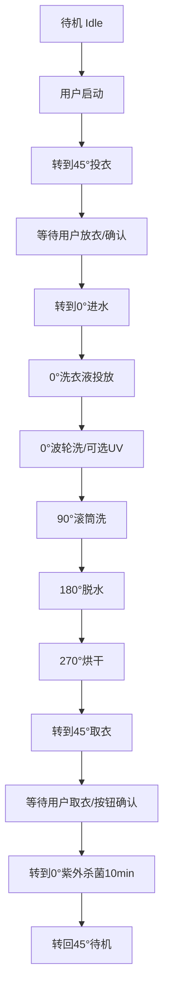

# ESP32-S3 IDF 重构新功能流程草案

> 基于 2026-07-21 新需求：外筒纵向姿态由 0/90/180 扩展为 0/45/90/180/270，位置检测改为霍尔磁性开关，机构支持 360°全角度旋转。

## 1. 本次核心变化

当前 Arduino 固件把外筒姿态默认成“三点半周机构”：

- 只有 0°、90°、180° 三个姿态。
- 执行器用目标姿态枚举大小简单判断转动方向。
- `CMD_TILT_BARREL` 只接受 0/90/180。
- UI、BLE、AI prompt、执行器安全规则都写死了三姿态。

新 IDF 版本不能只是在旧枚举里加两个值，而应该重建为“五点圆周姿态系统”：

- 支持 0°、45°、90°、180°、270°。
- 位置传感器统一改为霍尔磁性开关，只在对应磁铁靠近时触发。
- 外筒机构按 0-359°绝对角度建模，支持 360°全可转。
- LLM/按钮/BLE 可以请求姿态切换和洗涤动作，但每个动作执行前都必须由本地 planner/safety 校验对应安全姿态。

## 2. 新姿态定义

| 姿态 | 用途 | 说明 |
|---|---|---|
| 0° | 进水、波轮洗、UV 消毒、洗衣液投放 | 基础洗涤/投放姿态 |
| 45° | 用户启动后放衣服 | 上料/投衣姿态 |
| 90° | 滚筒洗 | 滚筒洗姿态 |
| 180° | 脱水 | 离心脱水姿态 |
| 270° | 烘干 | 烘干姿态 |

建议 IDF 中使用明确枚举，而不是裸数字散落在业务逻辑里：

```c
typedef enum {
    DRUM_POS_UNKNOWN = -1,
    DRUM_POS_0       = 0,
    DRUM_POS_45      = 45,
    DRUM_POS_90      = 90,
    DRUM_POS_180     = 180,
    DRUM_POS_270     = 270,
} drum_position_t;
```

## 3. 霍尔限位输入

新设计应把旧 `IPS` 概念改名为 `HallPosition` 或 `PositionSensor`，避免继续沿用“接近开关/IPS”的旧语义。

已确认：五个角度使用五路独立 GPIO 霍尔磁性开关，触发电平为低有效。

已确认：五个外筒姿态霍尔与 BLDC 寻零霍尔全部接入 MCP23017 GPB 组，MCP 的 INTB 聚合中断接 ESP32 GPIO13。

| 传感器 | 对应姿态 | 建议语义 |
|---|---:|---|
| MCP GPB0 / HALL_POS_0_N | 0° | 0°磁铁触发，低有效 |
| MCP GPB1 / HALL_POS_45_N | 45° | 45°磁铁触发，低有效 |
| MCP GPB2 / HALL_POS_90_N | 90° | 90°磁铁触发，低有效 |
| MCP GPB3 / HALL_POS_180_N | 180° | 180°磁铁触发，低有效 |
| MCP GPB4 / HALL_POS_270_N | 270° | 270°磁铁触发，低有效 |
| MCP GPB5 / HALL_BLDC_N | BLDC 寻零 | 内筒归位磁铁触发，低有效 |

驱动层需要提供这类接口：

```c
bool position_sensor_is_active(drum_position_t pos);
drum_position_t position_sensor_get_current(void);
uint32_t position_sensor_get_active_mask(void);
```

安全规则：

- 正常情况下同一时刻最多只有一个姿态霍尔触发。
- 如果多个姿态同时触发，判定为传感器异常，停止姿态电机并进入故障态。
- 如果姿态运动超时仍未触发目标霍尔，停止姿态电机并进入故障态。
- 霍尔为低有效输入，建议 GPIO 配置为上拉输入，最终按实际霍尔模块输出电路确认。
- 霍尔输入要做稳定消抖，建议 5-20ms 可配置，最终以实测为准。
- GPIO13 的 MCP INTB ISR 只置位事件标志，不在 ISR 内做 I2C。
- 姿态运动期间应由 `position_service` 主动高频读取 MCP GPIO/INTCAP，避免只依赖中断导致目标霍尔漏判。

## 4. 360°姿态运动策略

旧执行器使用步进电机，方向逻辑是：

```cpp
bool isForward = (targetPosture == POS_0) ? false : (targetPosture > realPosture);
```

这在 360°机构下不再成立。例如从 270°去 0°，按绝对大小判断会出错。

已确认：新外筒姿态旋转不再使用步进电机，改为 IBT-2 驱动的直流/减速电机：

| 信号 | GPIO | 用途 |
|---|---:|---|
| IBT2_RPWM / PWM_A | GPIO40 | 一个方向 PWM |
| IBT2_LPWM / PWM_B | GPIO41 | 另一个方向 PWM |
| IBT2_EN | GPIO48 | R_EN/L_EN 并联使能 |

姿态控制从“步进脉冲定位”改为“IBT-2 给方向和速度，靠目标霍尔触发停机”。

IDF 中建议实现圆周方向计算：

```c
typedef enum {
    ROTATE_CW,
    ROTATE_CCW,
} rotate_dir_t;

static rotate_dir_t choose_shortest_dir(int current_deg, int target_deg) {
    int cw = (target_deg - current_deg + 360) % 360;
    int ccw = (current_deg - target_deg + 360) % 360;
    return (cw <= ccw) ? ROTATE_CW : ROTATE_CCW;
}
```

已确认：机构允许无限同方向连续旋转。因此姿态服务可以把每次定位视为“沿圆周寻找目标霍尔”，不需要限制累计角度停留在 0-360°范围内。

运动策略建议：

- 是否永远走最短路径。
- 是否某些姿态切换必须固定方向，避免水管、电线、机械干涉。
- 如果没有线束/水管缠绕风险，默认可以使用最短路径；如果实际机构更适合同向循环，也可以配置为固定方向寻位。
- 到达目标霍尔后应立即关闭 PWM，再执行短暂电刹或空闲制动策略；具体刹车方式需要结合 IBT-2 接法和实际电机惯性调试。

## 5. 新动作到姿态映射

系统规划器必须在动作前校验姿态；如果 LLM/按钮/BLE 已请求正确姿态则复用，如果缺失或不安全则补齐/调整姿态切换：

| 动作 | 前置姿态 |
|---|---:|
| 用户启动/开盖投衣 | 45° |
| 进水 | 0° |
| 波轮洗 | 0° |
| UV 紫外消毒 | 0° |
| 洗衣液投放 | 0° |
| 滚筒洗 | 90° |
| 脱水 | 180° |
| 烘干 | 270° |

这意味着 AI、BLE、按键可以请求姿态和动作顺序，但不能直接控制 GPIO/PWM/继电器等裸硬件。IDF 的洗涤规划器负责校验姿态、补齐缺失姿态，并把请求编译成安全步骤。

建议规划层接口：

```c
machine_err_t plan_append_action(wash_action_t action);
machine_err_t planner_compile_to_steps(const wash_plan_t *plan, step_queue_t *queue);
```

编排原则：

- AI 可以生成洗涤功能动作，也可以请求姿态切换；本地系统负责校验姿态合法性，并在缺失或不安全时自动补齐/调整。
- 用户启动后，机器先进入 45°投衣姿态。
- 投衣确认后，再按流程进入 0°进水。
- 所有强动作启动前必须二次校验当前姿态。
- 姿态未到位时，禁止开启 BLDC、进水阀、UV、洗衣液泵、烘干负载。

## 6. 建议新增/调整命令

旧命令中还没有“洗衣液投放”和“烘干”两个明确动作，建议 IDF 协议补齐：

| 命令 | 功能 | 姿态 |
|---|---|---:|
| CMD_LOAD_POSITION | 进入投衣姿态 | 45° |
| CMD_WATER_IN | 进水 | 0° |
| CMD_DETERGENT_IN | 投放洗衣液 | 0° |
| CMD_WASH_PULSATOR | 波轮洗 | 0° |
| CMD_UV_STERILIZE | 紫外消毒 | 0° |
| CMD_WASH_DRUM | 滚筒洗 | 90° |
| CMD_SPIN_DRY | 脱水 | 180° |
| CMD_DRY | 烘干 | 270° |
| CMD_MOVE_TO_POSITION | 姿态切换请求/内部姿态步骤 | 0/45/90/180/270 |
| CMD_HOME_POSITION | 姿态寻零/校准 | 0°或最近霍尔 |

`CMD_MOVE_TO_POSITION` 可以作为 LLM/协议层的姿态请求，但最终必须由 `position_service` 执行，不能绕过姿态霍尔、超时和故障校验。

## 7. 建议状态机流程



是否洗衣液、滚筒洗、烘干都必做，后续按你的新工艺细节再定。

已确认的人机流程：

- 用户启动后转到 45° 投衣。
- 当前没有门锁/盖子确认输入，先用按钮作为投衣确认。
- 洗涤/烘干结束后默认转到 45°，方便用户取衣。
- 用户取完衣服后，用按钮确认，再转到 0° 进行 UV 紫外杀菌。
- UV 紫外杀菌默认持续 10min，期间 BTN3 可跳过。
- UV 杀菌完成或跳过后，机器再转回 45°待机。

## 8. IDF 模块拆分建议

建议把姿态控制从 `WashExecutor` 中独立出来：

| 模块 | 责任 |
|---|---|
| `position_service` | 霍尔读取、当前姿态判断、姿态运动、超时、故障 |
| `mcp23017_driver` | MCP 输入输出缓存、INTCAP/GPIO 读取、中断事件分发 |
| `motion_driver` | IBT-2 双 PWM、使能、停止/制动 |
| `wash_planner` | 把用户/AI动作转换为安全步骤 |
| `wash_executor` | 执行步骤队列，检查姿态和安全条件 |
| `safety_manager` | 故障态、互锁、急停、传感器冲突处理 |
| `app_protocol` | BLE/语音/Web/串口命令统一入口 |
| `button_service` | BTN1/BTN2/BTN3 去抖、单击事件；后续预留长按/双击/组合键 |
| `flow_meter` | GPIO18 PCNT 流量计计数、进水量估算、异常检测 |
| `sht_sensor` | SHT30/SHTC3 温湿度读取，服务烘干反馈 |
| `fan_driver` | GPIO38 PWM，同步控制双风扇 |
| `detergent_pump` | MCP GPB7 控制 5V 蠕动泵，按时间标定投放量 |

姿态服务应该是本地高优先级控制，不应被云端 AI、HTTP、TTS、显示刷新阻塞。

语音 Prompt 与洗涤 agent 协议单独整理在：

- `doc/IDF重构_语音Prompt与Agent协议设计_2026-07-21.md`

核心原则：语音/LLM 可以输出姿态、进水、排水、烘干等动作请求，但不能输出 GPIO/PWM/继电器裸控制；本地 `wash_planner` 负责编译安全步骤，`safety_manager` 负责硬件联锁。

## 9. MCP23017 执行输出

已确认：新板 MCP23017 不再只是少量 IO 扩展，而是阀门、UV、加热、泵、霍尔、按钮、手势中断的核心聚合器。旧工程里的 MCP 心跳 LED 与 EC11 按键分配不再保留。

执行输出分配：

| MCP 端口 | 功能 | 默认安全态 |
|---|---|---|
| GPA0 | 水龙头进水阀 | 关闭 |
| GPA1 | 水箱到洗涤桶阀 | 关闭 |
| GPA2 | UV 杀菌灯 | 关闭 |
| GPA3 | 洗涤桶排水阀 | 关闭 |
| GPA7 | PTC 加热器 | 关闭 |
| GPB7 | 洗衣液蠕动泵 | 关闭 |

输入/中断分配：

| MCP 端口 | 功能 | 语义 |
|---|---|---|
| GPB0-GPB5 | 0/45/90/180/270 与 BLDC 寻零霍尔 | 低有效 |
| GPB6 | PAJ7620 手势 INT | 低有效，手势结果仍通过 I2C 读取 PAJ7620 |
| GPA4-GPA6 | BTN1/BTN2/BTN3 | 低有效，替代旧 EC11 旋钮 |

IDF 中建议 `mcp23017_driver` 维护 GPA/GPB 输出影子寄存器：

```c
machine_err_t mcp_set_output(mcp_pin_t pin, bool on);
machine_err_t mcp_write_outputs_atomic(void);
machine_err_t mcp_read_inputs(mcp_input_snapshot_t *snapshot);
```

初始化原则：

- 上电先写 OLAT 默认全关闭，再配置输出方向。
- 所有高风险输出默认关闭，包括阀门、UV、PTC、泵。
- 多任务访问 MCP 必须走同一个驱动和互斥锁，禁止各模块各自 read-modify-write。
- PTC、UV、进水、排水、泵都要由 `safety_manager` 做授权，业务流程不能绕过安全层直接开输出。

## 10. 主洗涤电机 BL50 控制

已确认：主洗涤电机改用 BL50 控制器，软件需要管理四个信号：

| 信号 | GPIO | 用途 |
|---|---:|---|
| BL50_PWM | GPIO39 | 调速 PWM |
| BL50_DIR_CTRL | GPIO1 | 方向控制 |
| BL50_BRAKE_CTRL | GPIO2 | 刹车控制 |
| BL50_STOP_CTRL | GPIO21 | 停止/停车控制 |

旧 Arduino 工程中的 `BLDCMotor` 只抽象了 PWM + DIR，新 IDF 版本建议重写为 `bl50_driver`：

```c
machine_err_t bl50_set_speed(uint8_t duty_percent, bl50_dir_t dir);
machine_err_t bl50_brake(bool enable);
machine_err_t bl50_stop(bool enable);
machine_err_t bl50_coast(void);
```

初始化原则：

- 上电初始化必须先进入停止/刹车安全态，再允许输出 PWM。
- PWM 默认 0，占空比斜坡启动，避免冲击。
- BRAKE/STOP 的有效电平要按最终硬件驱动电路实测确认；HTML 中提示 BL50 控制线默认 5V 高电平、由 2N7002/等效开漏下拉动作，软件抽象层不要直接暴露裸 GPIO 电平语义。
- 外筒姿态未到位、门盖未满足安全条件、水位/故障异常时，禁止启动 BL50。
- 当前没有门锁/盖子检测输入；投衣/取衣确认先由按钮事件完成。后续如果增加门锁/盖子传感器，再接入 `safety_manager`。

## 11. 本地交互与流量计

已确认：旧 EC11 旋钮取消，新板改为三个独立按钮：

| 输入 | 端口 | 语义 |
|---|---|---|
| BTN1 | MCP GPA4 | 单击启动正式洗涤程序 |
| BTN2 | MCP GPA5 | 单击启动 Demo 洗涤程序 |
| BTN3 | MCP GPA6 | 单击中断当前洗涤，关闭水阀并执行洗涤桶复位；UV 阶段单击跳过 UV |

已确认：GPIO18 改为流量计 PCNT 输入：

| 信号 | GPIO | 用途 |
|---|---:|---|
| FLOW_PCNT | GPIO18 | 进水流量脉冲计数 |

IDF 规划：

- 旧 `DRV_GetEncoderValue()`、EC11 A/B 相解码、旋钮菜单逻辑不迁移。
- BTN1/BTN2/BTN3 通过 MCP 中断进入 `button_service`，再转换为启动、确认、暂停、取消等业务事件。
- BTN3 属于安全优先级输入：任意洗涤/进水/执行阶段单击时，应停止当前流程、关闭水阀、关闭高风险输出，并执行洗涤桶复位流程。
- 已确认 BTN3 洗涤桶复位目标为：外筒回 45° + BL50 内筒寻零。
- 在取衣后 UV 阶段，BTN3 单击用于跳过 UV，并进入回 45°待机流程。
- `flow_meter` 使用 ESP-IDF PCNT/脉冲计数驱动；现有水位传感器测洗涤桶水位，不测中间水箱。
- 已确认流量计用于进水计量和异常检测，包括有无水流判断、估算进水量。
- 进水步骤不应只依赖时间或水位，应支持“水位满、目标流量、超时、无脉冲异常”多条件判断。
- 流量计每升脉冲数/校准系数待实测标定。

## 12. 音频引脚与功放使能

已确认：I2S 麦克风输入保持不变，功放输出 DIN 迁移并新增功放使能。

| 信号 | GPIO | 用途 |
|---|---:|---|
| I2S_WS | GPIO15 | INMP441 + MAX98357 共用 WS |
| I2S_BCLK | GPIO16 | INMP441 + MAX98357 共用 BCLK |
| MIC_I2S_SD | GPIO17 | INMP441 数据输入 |
| I2S_AMP_DIN | GPIO14 | MAX98357 数据输出 |
| AMP_SD | GPIO47 | 功放使能/静音控制 |

IDF 初始化建议：

- 上电先保持 `AMP_SD` 为静音/关闭态，再初始化 I2S TX。
- TTS 播放前打开功放，播放结束后延迟短时间再静音，避免爆音。
- GPIO19/20 不再用于音频，按新 HTML 作为 USB 复用受限备用脚处理，不接执行器。

## 13. I2C 温湿度探头

已确认：新板在 I2C 总线上新增 SHT30/SHTC3 温湿度探头，与 MCP23017 和 PAJ7620 共用 GPIO6/7。

| 设备 | 总线 | 常见地址 | 用途 |
|---|---|---|---|
| MCP23017 | GPIO6/7 I2C | 0x20 | IO 扩展 |
| PAJ7620 | GPIO6/7 I2C | 常见 0x73 | 手势识别 |
| SHT30/SHTC3 | GPIO6/7 I2C | SHT30 常见 0x44/0x45 | 温湿度反馈，主要服务烘干 |

IDF 设计建议：

- I2C 总线必须统一由 `i2c_bus_manager` 或等价互斥锁管理。
- MCP、PAJ、SHT 读写不能在 ISR 内执行。
- 上电初始化时做 I2C 扫描/设备探测，记录实际 SHT 型号和地址。
- 烘干控制不要只按固定时间，应支持温度、湿度、最高温、传感器故障等条件。

## 14. 烘干风扇

已确认：新板新增双风扇，由 GPIO38 单路 PWM 同步调速，主要用于烘干/通风。

| 信号 | GPIO | 用途 |
|---|---:|---|
| FAN_PWM | GPIO38 | 双风扇同步 PWM |

IDF 设计建议：

- `fan_driver` 提供百分比速度接口，不向业务层暴露 PWM 细节。
- 默认上电关闭风扇。
- 烘干时建议先开风扇再允许 PTC 加热，停止烘干时先关 PTC，延时散热后再关风扇。
- 当前按无转速反馈设计；如果后续增加 FG 反馈，再加入堵转/断线检测。

## 15. PTC 加热器

已确认：烘干加热使用 220VAC/400W PTC，加热继电器由 MCP GPA7 控制。

| 信号 | 端口 | 用途 |
|---|---|---|
| HEATER_EN | MCP GPA7 | PTC 加热器继电器控制 |

安全联锁建议：

- PTC 默认关闭，上电、复位、故障、暂停、开盖/门锁异常时必须关闭。
- 禁止业务层直接打开 PTC，必须由 `safety_manager` 授权。
- 启动烘干时先确认外筒在 270°、风扇已开启、温湿度传感器有效，再允许加热。
- 停止烘干时先关闭 PTC，再保持风扇延时散热。
- 必须有最大加热时长、最高温度、传感器失效、I2C 异常等软件保护。
- 硬件温度保险丝/热熔断器属于最后防线，不替代软件控制。
- 已确认当前没有软件可读取的独立过温/温控反馈输入，只有硬件温度保险丝。软件层以 SHT 温湿度读数、最大加热时长、风扇联锁、传感器故障检测作为主要保护。

## 16. 洗衣液蠕动泵

已确认：洗衣液投放使用 5V 蠕动泵，由 MCP GPB7 控制开关。当前未标定，先按运行时间标定投放量。

| 信号 | 端口 | 用途 |
|---|---|---|
| PUMP_CTRL | MCP GPB7 | 洗衣液蠕动泵开关 |

IDF 设计建议：

- 洗衣液投放动作固定要求外筒在 0°。
- 上电默认关闭泵。
- 初期命令参数可用运行秒数；标定后建议上层使用 ml，驱动层换算为运行时间。
- 当前无流量/余量反馈，应至少提供最大单次运行时长、泵超时保护和可取消机制。
- 如果后续增加余量检测或泵反馈，再升级为闭环投放。

## 17. 正式程序与 Demo 程序

已确认：正式洗涤程序和 Demo 洗涤程序使用同一套动作流程模板，区别主要是各环节时长和强度参数。

设计目标：

- 正式洗涤：按真实衣服洗涤需要设置各环节时间。
- Demo 洗涤：面向比赛评委/投资人展示动作概念，总时长理想情况下不超过 3min。
- Demo 只需让关键外设和姿态动作“看得见”：45°投衣、0°进水/投液/波轮、90°滚筒、180°脱水、270°烘干、45°取衣、0° UV、回 45°待机。

建议 IDF 中用程序参数表实现，而不是写两份状态机：

```c
typedef struct {
    uint16_t water_in_max_sec;
    uint16_t detergent_sec;
    uint16_t pulsator_sec;
    uint16_t drum_sec;
    uint16_t drain_sec;
    uint16_t spin_sec;
    uint16_t dry_sec;
    uint16_t uv_sec;
    bool enable_dry;
} wash_program_profile_t;
```

初步 Demo 参数建议，后续可按现场观感调：

| 环节 | 姿态 | Demo 建议 |
|---|---:|---:|
| 投衣等待 | 45° | 按钮确认，不计入自动流程 |
| 进水演示 | 0° | 10-15s，或检测到少量流量后进入下一步 |
| 洗衣液投放 | 0° | 2-3s |
| 波轮洗 | 0° | 20-30s |
| 滚筒洗 | 90° | 20-30s |
| 排水演示 | 180° | 8-12s |
| 脱水 | 180° | 20-30s |
| 烘干演示 | 270° | 20-30s，风扇优先，PTC 短时加热 |
| 取衣等待 | 45° | 按钮确认，不计入自动流程 |
| UV | 0° | Demo 可 10-20s；正式取衣后 UV 为 10min |
| 回待机 | 45° | 到位即完成 |

已确认：

- Demo 程序中的烘干环节允许 PTC 短时加热，但仍必须满足风扇先行、温湿度有效、超时保护等联锁。
- 排水姿态固定为 180°。
- 正式洗涤程序默认总时长先设置为 30min，后续可修改；洗涤 agent 也可以根据任务调整流程参数。

正式程序默认 30min 参数建议，后续可由洗涤 agent 或配置表调整：

| 环节 | 姿态 | 默认建议 |
|---|---:|---:|
| 投衣等待 | 45° | 按钮确认，不计入自动流程 |
| 进水 | 0° | 2-4min，受水位/流量/超时共同控制 |
| 洗衣液投放 | 0° | 运行时间待标定 |
| 波轮洗 | 0° | 8-10min |
| 滚筒洗 | 90° | 6-8min |
| 排水 | 180° | 2-3min |
| 脱水 | 180° | 4-5min |
| 烘干 | 270° | 5-8min，受温湿度/温度上限/超时控制 |
| 取衣等待 | 45° | 按钮确认，不计入自动流程 |
| 取衣后 UV | 0° | 10min，BTN3 可跳过 |
| 回待机 | 45° | 到位即完成 |

洗涤 agent 调参边界已确认：

| 约束 | 规则 |
|---|---|
| 最大总时长 | 1h |
| 最大烘干时长 | 30min |
| 进水 | 不允许跳过 |
| 排水 | 不允许跳过 |
| 波轮洗 | 可由 agent 自定义轮数、次序、时间 |
| 滚筒洗 | 可由 agent 自定义轮数、次序、时间 |
| 脱水 | 可由 agent 自定义轮数、次序、时间 |
| UV 紫外 | 可由 agent 自定义或关闭；例如羊毛等生物织料可关闭 UV |

planner/safety 规则：

- agent 提交“洗涤动作请求/动作参数”，可以包含姿态切换、进水、排水、烘干；最终步骤必须由本地 planner 编译。
- 本地 planner 必须强制保留进水和排水步骤，不能接受跳过。
- 本地 planner 必须检查总时长不超过 1h、烘干不超过 30min。
- 波轮洗、滚筒洗、脱水可以多轮组合，但每次动作前仍由系统自动插入并校验姿态。
- UV 可选，但如果启用必须在 0°，并受最大时长、用户 BTN3 跳过和材质规则约束。
- 第一版暂不设置最大进水量硬上限，进水保护依赖水位满、流量异常和超时保护。

## 18. 与旧代码的主要差异点

需要重写/调整的旧假设：

- `DrumPosture` 从三枚举扩展为五姿态绝对角度。
- `DRV_ReadIPS()` 改为 MCP 霍尔姿态读取，支持 0/45/90/180/270。
- `SensorState_t` 从 0/90/180/BLDC 扩展为五姿态霍尔 + BLDC home。
- 霍尔输入从 ESP32 直读迁移到 MCP23017 GPB0-GPB5，GPIO13 仅作为聚合中断。
- MCP 输出从旧进水阀/UV/心跳 LED 扩展为三路阀门、UV、PTC、洗衣液泵，旧心跳 LED 分配取消。
- PAJ7620 手势 INT 从 GPIO8 迁移到 MCP GPB6，GPIO8 释放为空闲 GPIO。
- EC11 旋钮取消，改为 MCP GPA4-GPA6 三个按钮；GPIO18 从编码器 A 相改为流量计 PCNT。
- GPIO18 流量计参与进水计量和异常检测，不只是显示数据。
- 功放 DIN 从 GPIO19 迁移到 GPIO14，新增 GPIO47 `AMP_SD` 静音/使能控制。
- I2C 总线新增 SHT30/SHTC3 温湿度探头，烘干流程需要读取温湿度反馈。
- 新增 GPIO38 双风扇 PWM，烘干流程需要风扇先行/延时散热策略。
- 新增 MCP GPA7 PTC 加热控制，必须纳入高风险安全联锁。
- 新增 MCP GPB7 洗衣液蠕动泵控制，初期按运行时间标定投放量。
- BTN3 中断复位目标为外筒 45° + BL50 内筒寻零。
- 正式程序与 Demo 程序共用流程模板，区别用参数表控制；Demo 总时长目标不超过 3min。
- Demo 烘干允许 PTC 短时加热；排水姿态固定 180°；正式程序默认总时长 30min，可由配置/洗涤 agent 调整。
- 洗涤 agent 调参边界：最大总时长 1h，最大烘干 30min，进水/排水不可跳过；波轮/滚筒/脱水轮数、次序、时间可自定义；UV 可自定义或关闭。
- 姿态方向选择不能再用枚举大小比较。
- 外筒换位驱动从 FastAccelStepper 步进脉冲改为 IBT-2 双 PWM。
- 主洗涤电机驱动从旧 PWM+DIR 改为 BL50 PWM+DIR+BRAKE+STOP 四线控制。
- `CMD_TILT_BARREL` 的 `val` 合法值从 0/90/180 变为 0/45/90/180/270。
- AI prompt 中的姿态规则要改为“允许请求姿态，但本地校验/补齐/调整”。
- BLE 和 UI 的姿态显示要增加 45/270。
- 新增洗衣液投放和烘干动作。
- 执行器中每个功能动作启动前都要检查姿态，而不是相信队列前一步已经到位。

## 19. 当前待你确认的问题

已确认：

- 五个霍尔开关为五路独立 GPIO。
- 霍尔触发为低电平有效。
- 机构允许无限同方向连续旋转。
- 外筒姿态电机改为 IBT-2 驱动的直流/减速电机。
- 主洗涤电机改用 BL50 四线控制。
- 六路霍尔统一进入 MCP23017 GPB0-GPB5，通过 GPIO13 INTB 通知主控读取。
- MCP23017 控制三路阀门、UV、PTC 加热器和洗衣液蠕动泵，旧 MCP 心跳 LED/EC11 按键分配取消。
- PAJ7620 手势模块保留，INT 迁移到 MCP GPB6，由 MCP INTB/GPIO13 聚合通知。
- EC11 旋钮取消，改为 BTN1/BTN2/BTN3；GPIO18 改为流量计 PCNT 输入。
- 功放 DIN 迁移到 GPIO14，新增 GPIO47 AMP_SD 使能/静音控制。
- I2C 总线新增 SHT30/SHTC3 温湿度探头，用于烘干/温湿度反馈。
- 新增双风扇，由 GPIO38 单路 PWM 同步调速，主要用于烘干/通风。
- GPIO18 流量计用于进水计量和异常检测，包括有无水流判断和估算进水量。
- 烘干加热使用 220VAC/400W PTC，由 MCP GPA7 控制继电器，并与风扇、温湿度、故障保护联锁。
- 洗衣液投放使用 5V 蠕动泵，由 MCP GPB7 控制开关，当前未标定，先按运行时间标定投放量。
- 当前没有门锁/盖子确认输入，投衣和取衣确认先用按钮控制。
- 当前没有软件过温输入，只有硬件温度保险丝。
- 完成后默认停在 45° 取衣；取完衣服按钮确认后，转到 0° 进行 UV 紫外杀菌。
- BTN1/BTN2/BTN3 单击分别为正式洗涤、Demo 洗涤、中断洗涤桶复位并关闭水阀。
- 取衣后 0° UV 紫外杀菌默认 10min，BTN3 可跳过。
- UV 杀菌完成或跳过后，机器最终回到 45°待机。
- BTN3 洗涤桶复位目标为外筒回 45° + BL50 内筒寻零。
- 正式洗涤程序和 Demo 洗涤程序共用流程模板，Demo 总时长目标不超过 3min，正式程序按真实衣物洗涤时长。
- Demo 烘干环节 PTC 短时加热。
- 排水姿态固定为 180°。
- 正式洗涤程序默认 30min，后续可修改，洗涤 agent 可调整参数。
- 洗涤 agent 调参边界：最大总时长 1h，最大烘干时长 30min；进水/排水不能跳过；波轮洗、滚筒洗、脱水的轮数/次序/时间可自定义；UV 可自定义或关闭。
- 第一版进水不设最大水量硬上限，依赖水位满、流量异常、超时保护。
- BTN1/BTN2/BTN3 第一版只使用单击；后续预留长按、双击、组合键功能。

后续扩展：

1. 按钮长按、双击、组合键功能定义。
2. 更精细的水量控制：流量计标定后可增加目标水量/最大水量策略。

## 20. 小程序 BLE 通讯与握手

小程序通讯协议独立成文档维护：

- [IDF重构_小程序BLE通讯协议设计_2026-07-21.md](./IDF重构_小程序BLE通讯协议设计_2026-07-21.md)

设计原则：

- 连接握手参考原 Arduino BLE 方式：设备名 `JJTP-XIAOJING`，服务 `FFF0`，写特征 `FFF1`，通知特征 `FFF2`。
- 新版协议在原有连接方式上增加 `hello / ack / status / cap`，让小程序明确知道设备能力、姿态枚举、最大时长、安全限制。
- 保留旧小程序兼容入口：旧的 `{"cmd":"start"}` / `{"cmd":"stop"}` 仍可映射为新版正式洗涤 / 中断复位。
- 小程序和语音共用同一套 `app_protocol` 动作语义：可以请求姿态切换、进水、排水、烘干等动作，但不能直接控制 GPIO、继电器、PTC、风扇、水阀裸硬件。

小程序端改造指导独立成文档维护：

- [IDF重构_小程序端改造指导_2026-07-21.md](./IDF重构_小程序端改造指导_2026-07-21.md)

## 21. 最新补充确认项

### 21.1 IBT-2 姿态电机方向

IBT-2 的实际方向需要装机后实测确认。IDF 第一版不要把 `RPWM=顺时针` 或 `LPWM=逆时针` 写死在业务逻辑里，而应在配置层提供：

```c
typedef enum {
    POSITION_MOTOR_DIR_CW,
    POSITION_MOTOR_DIR_CCW,
} position_motor_dir_t;

typedef struct {
    bool rpwm_is_cw;          // 实测后填写
    bool prefer_single_dir;   // 第一版可先 true：无限同方向找目标霍尔
} position_motor_config_t;
```

建议第一版采用“允许无限同方向连续转”的简单策略：找目标姿态时只沿配置方向转，直到目标霍尔稳定触发。待方向、惯性、刹车距离实测后，再决定是否加入最近方向优化。

### 21.2 霍尔输入防抖

霍尔磁性开关为低电平有效，但仍需要非阻塞防抖。建议每路维护原始电平、稳定电平、最后变化时间：

- 主循环或定时任务周期读取 MCP GPB0-GPB5。
- 某路原始状态变化后，只有持续稳定 `20-50ms` 才更新为有效状态。
- 姿态判定只使用防抖后的稳定状态。
- 若稳定后同时出现两个及以上姿态霍尔有效，进入 `HALL_CONFLICT`。
- 若姿态电机运行超过配置超时时间仍未等到目标霍尔，进入 `POSITION_TIMEOUT`。

### 21.3 进水水路

进水流程确认为二级水路：

1. 先打开自来水进水阀，将水进入某个中间水箱/储水箱。
2. 再打开转移阀，将水箱中的水转移进洗涤桶。
3. 转移后检查洗涤桶水位；未满则重复“中间水箱进水 -> 转移”，直到洗涤桶水位满。

因此 IDF 中不建议把进水抽象成单个 `valve_on`，而应拆为 `water_source_fill` 与 `water_transfer_to_drum` 两个内部阶段；对小程序/语音仍暴露统一的 `water_in` 动作。

第一版保护：

- 姿态必须为 0°。
- 已确认水位传感器测洗涤桶；水位满是整个 `water_in` 的正常完成条件。
- 中间水箱没有使用该水位反馈，SOURCE_FILL 必须设置单批进水脉冲/时间上限，防止中间水箱溢流。
- 监控流量计是否有脉冲，判断无水流/异常低流量。
- 设置进水总超时。
- 设置最大进水批次数，避免洗涤桶水位传感器异常时无限循环。
- 流量计参数预留，暂不设置最大水量硬上限。

### 21.4 排水

排水确认为仅排水阀，无排水泵。排水动作固定要求姿态 180°，打开 MCP GPA3 排水阀，并通过时间/水位变化/超时保护完成。

### 21.5 烘干保守策略

烘干温度策略暂定，但第一版必须保守。建议默认约束如下，后续可根据实测修改：

| 项目 | 建议默认值 |
|---|---:|
| 烘干姿态 | 270° |
| 风扇预吹 | PTC 开启前至少 5s |
| PTC 单次连续开启上限 | 60s |
| PTC 周期控制 | 60s 开 / 60s 关，或更保守 |
| 软件温度上限 | SHT 温度 ≥ 55°C 关闭 PTC |
| 温度恢复阈值 | SHT 温度 ≤ 45°C 才允许再次开启 PTC |
| SHT 读数失效 | 禁止开启 PTC，仅允许风扇 |
| 烘干结束散热 | PTC 关闭后风扇继续 60s |
| 最大烘干时长 | 30min |
| Demo PTC 加热 | 仅短时演示，建议 10-20s |

说明：当前只有硬件温度保险丝，软件温度不应追求高温烘干效果，第一版目标是“能安全演示和轻度通风烘干”。

### 21.6 流量计参数预留

第一版先预留配置：

```c
typedef struct {
    uint32_t pulses_per_liter;          // 待标定
    uint32_t no_flow_timeout_ms;        // 建议 3000-5000
    uint32_t low_flow_window_ms;        // 建议 5000
    uint32_t inlet_timeout_ms;          // 建议 180000-240000
    bool enable_volume_estimation;      // 标定前可 false
} flow_meter_config_t;
```

### 21.7 洗衣液泵默认参数

洗衣液蠕动泵当前未标定，第一版按运行时间控制：

| 程序 | 默认投放时间 |
|---|---:|
| Demo | 2-3s |
| 正式洗涤 | 6s |

建议预留配置项：

```c
typedef struct {
    uint32_t detergent_demo_ms;
    uint32_t detergent_formal_ms;
    uint32_t detergent_max_single_ms;
    float ml_per_second;                // 标定后填写，未标定可为 0
} detergent_pump_config_t;
```

安全约束：洗衣液投放必须在 0°，单次运行时间不得超过 `detergent_max_single_ms`，中断/故障时立即关闭 MCP GPB7。

## 22. ESP-IDF 组件与任务模型

七个核心组件的责任、FreeRTOS 任务划分、公共数据契约和头文件级接口已经单独整理：

- [ESP-IDF重构_组件拆分与任务模型设计_2026-07-21.md](./ESP-IDF重构_组件拆分与任务模型设计_2026-07-21.md)

本阶段冻结的架构原则：

- `wash_planner` 是不访问硬件的纯编译组件。
- `wash_executor` 是整机流程唯一状态机。
- `position_service`、`water_service`、`dry_service` 使用异步请求和带 `request_id` 的完成事件。
- `safety_manager` 是高风险输出的唯一运行时授权入口，支持非阻塞紧急停机钩子。
- `ble_transport` 只处理 BLE 字节流与分包，`voice_agent` 只产生统一产品意图；两者都不能绕过 planner/safety。
